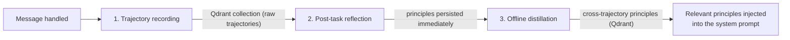

# Experience System

The experience subsystem is **opt-in**. `ExperienceConfig.enabled` defaults to
`false`; the server only builds the service when `[experience].enabled = true`
(the sample `orka.toml` turns it on). When enabled, it records run trajectories
and can distill them into reusable principles that are later retrieved into the
system prompt. It has three phases:



---

## Configuration

```toml
[experience]
enabled         = false      # default in code; sample orka.toml sets true
reflect_on      = "failures" # "failures", "all", or "sampled"
max_principles  = 5          # max principles injected per turn
sample_rate     = 0.1        # fraction of tasks to reflect on (when reflect_on = "sampled")
```

| Key              | Default      | Description                                        |
| ---------------- | ------------ | -------------------------------------------------- |
| `enabled`        | `false`      | Enable the experience loop                         |
| `reflect_on`     | `"failures"` | Which tasks trigger reflection                     |
| `max_principles` | `5`          | Max principles injected into the system prompt     |
| `sample_rate`    | `0.1`        | Sampling probability when `reflect_on = "sampled"` |

---

## Phase 1: Trajectory Recording

When `[experience].enabled = true`, after a handled message the agent can
record a trajectory:

- User message, skill traces, iteration/token counts, errors, and the final
  reply (text fields are truncated for vector-store metadata)
- An outcome signal derived from skill failures and recorded errors
- Metadata: session ID, workspace name, timestamp, skill names used

Trajectories are stored in the Qdrant collection named by
`experience.trajectories_collection` (default `orka_trajectories`).

---

## Phase 2: Post-Task Reflection

Depending on `reflect_on`:

| Value        | Reflection triggered when…                               |
| ------------ | -------------------------------------------------------- |
| `"failures"` | The trajectory was marked unsuccessful (skill failure or recorded error) |
| `"all"`      | Every turn                                               |
| `"sampled"`  | Randomly, at `sample_rate` probability                   |

During reflection, a second LLM call analyses the trajectory and may persist
one or more **principles** immediately (deduplicated against the store) —
short, actionable instructions in the style of "When X, always Y".

Example principles:

```text
When using shell_exec, always check the exit code before proceeding.
Prefer read-only filesystem operations unless write access is explicitly requested.
```

---

## Phase 3: Offline Distillation

Distillation loads a batch of recent trajectories and asks the LLM to
synthesize cross-trajectory principles. It can be triggered:

- **Manually** via the API or CLI:

  ```bash
  orka experience distill
  ```

- **Automatically** by the server background loop when
  `experience.distillation_interval_secs` is greater than 0 (default 3600).
  Set the interval to `0` to disable the loop.

During distillation:

1. Up to `distillation_batch_size` recent trajectories are loaded from Qdrant.
2. The LLM synthesizes cross-trajectory patterns.
3. New principles are written to the principles collection (with dedup).

---

## Prompt Injection

Before each LLM call, the handler retrieves up to `max_principles` principles
that match the user message (vector search, `min_relevance_score`) and can
append them to the system prompt under a `## Learned Principles` section:

```text
## Learned Principles

1. When using shell_exec, always check the exit code before proceeding.
2. Prefer idempotent operations to avoid side effects on retry.
```

At most `max_principles` entries are injected to keep the prompt concise.

---

## CLI

```bash
# Check experience system status
orka experience status

# List current principles
orka experience principles

# Trigger distillation manually
orka experience distill
```

---

## API

| Method | Path                            | Description                 |
| ------ | ------------------------------- | --------------------------- |
| `GET`  | `/api/v1/experience/status`     | Status and trajectory count |
| `GET`  | `/api/v1/experience/principles` | Retrieve current principles |
| `POST` | `/api/v1/experience/distill`    | Trigger distillation        |

Example:

```bash
# Get principles
curl http://localhost:8080/api/v1/experience/principles | jq .

# Trigger distillation
curl -X POST http://localhost:8080/api/v1/experience/distill
```

---

## Tips

- Start with `reflect_on = "failures"` (default) to learn from mistakes without
  incurring extra LLM calls on every turn.
- Use `reflect_on = "sampled"` with `sample_rate = 0.1` for high-traffic agents
  to control reflection costs.
- Use `experience.distillation_interval_secs` (or `orka experience distill`)
  for periodic distillation. There is no built-in `experience_distill` skill.
- Inspect principles regularly with `orka experience principles` and trigger a
  new distillation if the quality degrades.
